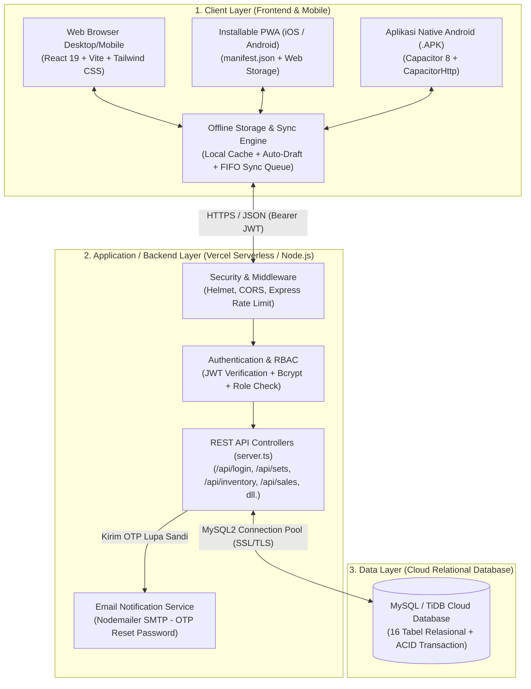
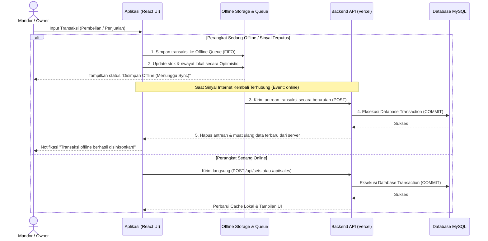
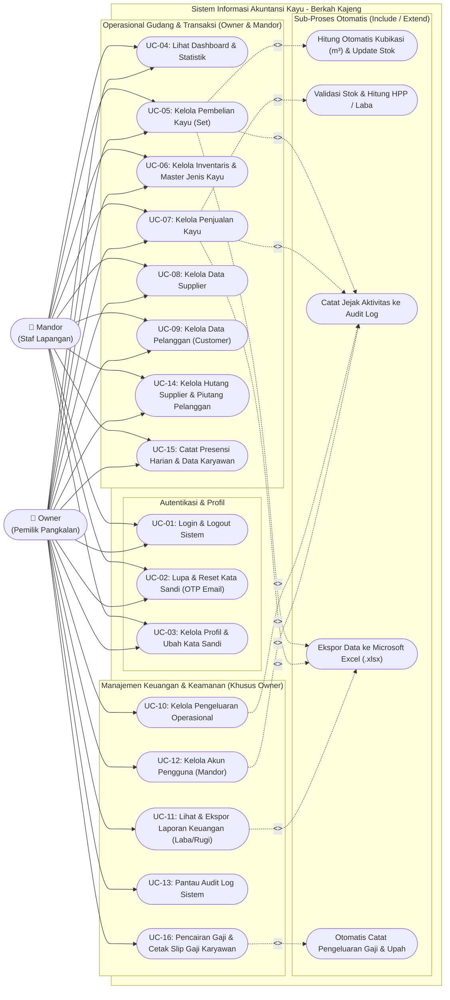
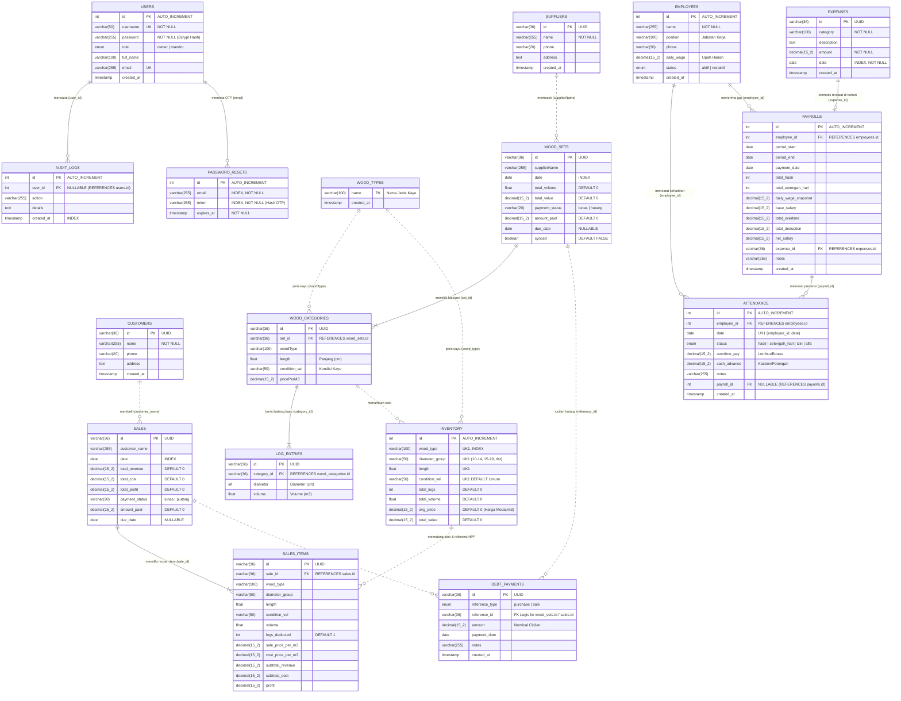
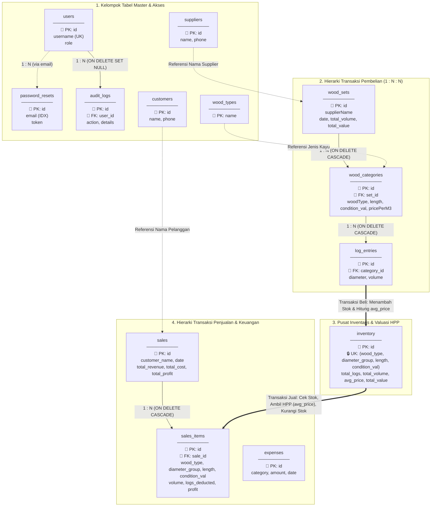

# 📘 DOKUMEN DESAIN SISTEM, USE CASE, ERD, DAN RELASI ANTAR TABEL
## Sistem Informasi Manajemen & Akuntansi Pangkalan Kayu — **Berkah Kajeng**

> **Nama Proyek**: Berkah Kajeng — Sistem Manajemen & Akuntansi Pangkalan Kayu  
> **Versi Dokumen**: 1.0.0  
> **Platform**: Web Application (PWA) & Mobile Android (Capacitor Hybrid APK)  
> **Basis Data**: MySQL / TiDB Cloud (Relational Database Management System)

---

## DAFTAR ISI
1. [BAB 1 — Desain Arsitektur Sistem](#bab-1--desain-arsitektur-sistem)
2. [BAB 2 — Use Case Diagram & Spesifikasi Use Case](#bab-2--use-case-diagram--spesifikasi-use-case)
3. [BAB 3 — Entity Relationship Diagram (ERD) & Struktur Tabel](#bab-3--entity-relationship-diagram-erd--struktur-tabel)
4. [BAB 4 — Relasi Antar Tabel & Aturan Bisnis Data](#bab-4--relasi-antar-tabel--aturan-bisnis-data)

---

# BAB 1 — Desain Arsitektur Sistem

## 1.1 Gambaran Umum Sistem
**Berkah Kajeng** adalah sistem informasi akuntansi dan manajemen inventaris kayu gelondongan (*logyard*) yang dirancang khusus untuk mendigitalisasi proses bisnis pangkalan kayu. Sistem ini menangani siklus operasional secara menyeluruh mulai dari:
1. **Pencatatan Pembelian Kayu (Set)** dari *Supplier* beserta pengukuran fisik per batang kayu (diameter, panjang, kondisi, dan jenis kayu).
2. **Manajemen Inventaris Otomatis** yang mengelompokkan stok berdasarkan jenis kayu, rentang diameter (`10-14`, `15-19`, `20-24`, `25-29`, `30+`), panjang, dan kondisi fisik dengan perhitungan harga modal rata-rata tertimbang (*Weighted Moving Average*).
3. **Pencatatan Penjualan Kayu** ke *Pelanggan (Customer)* yang secara otomatis memotong stok gudang dan menghitung Harga Pokok Penjualan (HPP) serta laba kotor per transaksi.
4. **Pencatatan Beban Operasional (Expenses)** dan **Laporan Keuangan Laba/Rugi Bersih** yang dapat diekspor ke dalam dokumen Microsoft Excel (`.xlsx`) terformat.
5. **Dukungan Operasional Offline-First (Opsi 3)** di mana Mandor tetap dapat menginput transaksi di lapangan saat tidak ada sinyal internet, yang kemudian disinkronkan secara otomatis (*FIFO Queue*) ketika perangkat kembali terhubung ke internet.

---

## 1.2 Diagram Arsitektur Sistem (*System Architecture*)
Sistem menggunakan arsitektur **Three-Tier Modern Web & Hybrid Mobile** yang terdiri dari *Client Layer* (Web, PWA, Android APK), *Application/API Layer* (Node.js + Express Serverless), dan *Data Layer* (MySQL / TiDB Cloud).

---

## 1.3 Spesifikasi Teknologi (*Technology Stack*)

| Lapisan Sistem | Teknologi / Pustaka | Fungsi Utama dalam Sistem |
| :--- | :--- | :--- |
| **Frontend UI** | React 19, TypeScript, Vite 6 | Membangun antarmuka pengguna reaktif (*Single Page Application*) yang cepat dan modular. |
| **Styling & Animasi** | Tailwind CSS 3, Framer Motion, Lucide React | Desain responsif (Mobile & Desktop), dukungan *Dark Mode*, dan transisi antarmuka halus. |
| **Visualisasi & Ekspor** | Recharts, `xlsx-js-style` | Grafik analitik Dashboard/Inventaris dan ekspor laporan keuangan/riwayat ke Excel (`.xlsx`). |
| **Mobile Wrapper** | Capacitor 8 (`@capacitor/android`) | Mengemas aplikasi web menjadi aplikasi Android native (`.apk`) dengan jaringan native (`CapacitorHttp`). |
| **Offline Engine** | `localStorage` Cache & FIFO Sync Queue | Menyimpan *cache* data stok/riwayat, *auto-save draft* pengukuran kayu, dan antrean transaksi saat *offline*. |
| **Backend Server** | Node.js, Express.js (`server.ts`) | Menyediakan layanan RESTful API, kalkulasi bisnis, transaksi database, dan otorisasi peran. |
| **Keamanan API** | JWT (`jsonwebtoken`), `bcryptjs`, `helmet`, `cors`, `express-rate-limit` | Autentikasi sesi berbasis token, *hashing* kata sandi, proteksi *brute-force*, dan keamanan HTTP header. |
| **Database** | MySQL / TiDB Cloud (`mysql2/promise`) | Penyimpanan data relasional dengan dukungan transaksi *ACID* (`BEGIN`, `COMMIT`, `ROLLBACK`). |

---

## 1.4 Desain Mekanisme Offline & Sinkronisasi (Offline-First Architecture)

---

# BAB 2 — Use Case Diagram & Spesifikasi Use Case

## 2.1 Identifikasi Aktor (*Actors*)
Sistem menerapkan **Role-Based Access Control (RBAC)** dengan dua aktor utama:

| Aktor | Peran di Bisnis | Hak Akses di Dalam Sistem |
| :--- | :--- | :--- |
| **1. Owner (Pemilik Pangkalan)** | Pemilik usaha yang mengawasi keuangan, operasional, stok, dan pengguna. | **Akses Penuh (Full Access):** Dapat mengakses seluruh modul operasional (Dashboard Keuangan lengkap, Pembelian, Inventaris, Penjualan, Supplier, Pelanggan) **ditambah** modul khusus Owner: **Pengeluaran Operasional**, **Laporan Keuangan & Ekspor Excel**, **Manajemen Akun Mandor**, dan **Audit Log**. |
| **2. Mandor (Staf Lapangan)** | Petugas operasional di pangkalan kayu yang mengukur kayu masuk dan melayani penjualan. | **Akses Operasional Terbatas:** Dapat mengakses **Dashboard Operasional** (tanpa rincian laba/margin rahasia), **Pembelian (Set)**, **Inventaris**, **Penjualan**, **Data Supplier**, **Data Pelanggan**, dan **Profil Saya**. |

---

## 2.2 Diagram Use Case (*Use Case Diagram*)

---

## 2.3 Matriks Hak Akses & Deskripsi Use Case

| Kode | Nama Use Case | Aktor | Deskripsi Fungsional |
| :---: | :--- | :---: | :--- |
| **UC-01** | Login & Logout Sistem | Owner, Mandor | Memverifikasi `username` & `password` menggunakan Bcrypt, menerbitkan token JWT (berlaku 24 jam), dan membatasi percobaan gagal (*rate limit*). |
| **UC-02** | Lupa & Reset Kata Sandi | Owner, Mandor | Mengirimkan kode OTP 6 digit ke email terdaftar dan mengatur ulang kata sandi baru. |
| **UC-03** | Kelola Profil Pengguna | Owner, Mandor | Mengubah nama lengkap, alamat email, dan memperbarui kata sandi akun yang sedang aktif. |
| **UC-04** | Lihat Dashboard | Owner, Mandor | Menampilkan ringkasan metrik bisnis, grafik tren bulanan, komposisi stok kayu, dan aktivitas transaksi terakhir. |
| **UC-05** | Kelola Pembelian Kayu (Set) | Owner, Mandor | Mencatat pembelian kayu per Set (Supplier, Tanggal, Kategori Kayu, Daftar Diameter Batang), menghitung kubikasi otomatis, memperbarui stok inventaris, dan mengekspor riwayat pembelian ke Excel. |
| **UC-06** | Kelola Inventaris & Jenis Kayu | Owner, Mandor | Memantau jumlah batang, volume ($\text{m}^3$), harga modal rata-rata, dan nilai aset stok per kelompok diameter serta menambah/menghapus master jenis kayu. |
| **UC-07** | Kelola Penjualan Kayu | Owner, Mandor | Mencatat transaksi penjualan kayu ke pelanggan, memvalidasi kecukupan stok, menghitung HPP & laba otomatis, memotong stok inventaris, dan mengekspor riwayat penjualan ke Excel. |
| **UC-08** | Kelola Data Supplier | Owner, Mandor | Menambah, mencari, dan menghapus data kontak pemasok kayu (*Supplier*). |
| **UC-09** | Kelola Data Pelanggan | Owner, Mandor | Menambah, mencari, dan menghapus data kontak pembeli kayu (*Customer*). |
| **UC-10** | Kelola Pengeluaran Operasional | **Owner** | Mencatat, mengubah, dan menghapus biaya operasional harian (Gaji/Upah, Transportasi, BBM, Konsumsi, dll.). |
| **UC-11** | Lihat & Ekspor Laporan Keuangan | **Owner** | Menyajikan laporan Laba/Rugi Bersih (`Pendapatan Kotor - HPP - Biaya Operasional`), analisis margin per jenis kayu, filter periode tanggal, dan ekspor laporan ke Excel multi-sheet. |
| **UC-12** | Kelola Akun Mandor | **Owner** | Membuat akun pengguna baru (Mandor/Owner), mengubah data/password pengguna, dan menghapus akun Mandor. |
| **UC-13** | Pantau Audit Log | **Owner** | Melihat rekam jejak waktu (*timestamp*), pelaku (`username`), jenis aksi (`action`), dan detail perubahan seluruh aktivitas di dalam sistem. |
| **UC-14** | Kelola Hutang & Piutang | Owner, Mandor | Memantau sisa hutang pembelian ke Supplier dan piutang penjualan dari Pelanggan, indikator jatuh tempo, serta mencatat riwayat pembayaran cicilan bertahap (`debt_payments`). |
| **UC-15** | Catat Presensi Harian & Karyawan | Owner, Mandor | Mengelola daftar pekerja harian (`employees`) dan mencatat kehadiran harian (`hadir`, `setengah_hari`, `izin`, `alfa`), lembur/bonus, serta potongan kasbon (`attendance`). |
| **UC-16** | Pencairan Gaji & Slip Gaji | **Owner** | Menghitung otomatis gaji bersih dari rekap presensi yang belum dibayar, mencairkan gaji (`payrolls`), mencetak Slip Gaji, dan otomatis mencatat ke tabel `expenses` (kategori `Gaji & Upah`). |

---

## 2.4 Spesifikasi Skenario Use Case Utama

### A. Spesifikasi UC-05: Kelola Pembelian Kayu (Set)
- **Aktor Utama**: Mandor / Owner
- **Kondisi Awal (*Pre-condition*)**: Aktor telah berhasil login ke dalam sistem.
- **Kondisi Akhir (*Post-condition*)**: Data Set Pembelian, Kategori Kayu, dan Batang Kayu (`log_entries`) tersimpan; stok `inventory` bertambah beserta pembaruan harga rata-rata (`avg_price`); aktivitas tercatat di `audit_logs`.
- **Alur Utama (*Main Flow*)**:
  1. Aktor membuka menu **Pembelian (Set)** dan membuat Set baru.
  2. Aktor memilih/mengisi `supplierName` dan `date` (tanggal transaksi).
  3. Aktor menambahkan **Kategori Kayu** dengan memilih `woodType` (misal: Sengon), `length` (cm), `condition` (misal: C/Standar), dan `pricePerM3` (Rp).
  4. Aktor menginput `diameter` (cm) untuk setiap batang kayu gelondongan yang diukur.
  5. Sistem secara otomatis menghitung volume per batang ($\text{m}^3$), mengelompokkannya ke rentang diameter (`10-14`, `15-19`, `20-24`, `25-29`, `30+`), dan menjumlahkan total volume serta total nilai rupiah (dibulatkan ke Rp 1.000 terdekat).
  6. Aktor menekan tombol **Simpan Set**.
  7. Sistem menyimpan data ke tabel `wood_sets`, `wood_categories`, dan `log_entries` dalam satu transaksi database, lalu memperbarui stok di tabel `inventory`.
- **Alur Alternatif (*Offline Flow*)**:
  - *6a. Perangkat sedang tidak terhubung ke internet:* Sistem menyimpan Set Pembelian ke dalam *Offline Sync Queue* (`localStorage`), memperbarui tampilan stok lokal secara langsung (*optimistic update*), dan menyinkronkannya ke server secara otomatis saat koneksi internet kembali tersedia.

### B. Spesifikasi UC-07: Kelola Penjualan Kayu
- **Aktor Utama**: Mandor / Owner
- **Kondisi Awal (*Pre-condition*)**: Aktor telah login dan terdapat stok kayu tersedia di tabel `inventory`.
- **Kondisi Akhir (*Post-condition*)**: Faktur penjualan (`sales`) beserta rincian item (`sales_items`) tersimpan; volume dan jumlah batang pada `inventory` berkurang secara proporsional; jejak transaksi tercatat di `audit_logs`.
- **Alur Utama (*Main Flow*)**:
  1. Aktor membuka menu **Penjualan** dan menekan tombol pencatatan penjualan baru.
  2. Aktor mengisi `customer_name` dan `date`.
  3. Aktor memilih item stok kayu yang tersedia dari inventaris (`wood_type`, `length`, `diameter_group`, `condition_val`).
  4. Sistem menampilkan sisa volume tersedia dan harga modal rata-rata (`cost_price_per_m3`).
  5. Aktor mengisi `volume` ($\text{m}^3$) yang dijual dan `sale_price_per_m3` (harga jual per $\text{m}^3$).
  6. Sistem menghitung otomatis `subtotal_revenue`, `subtotal_cost` (HPP), dan `profit` (laba kotor).
  7. Aktor menekan **Simpan Penjualan**.
  8. Sistem memvalidasi bahwa volume yang dijual tidak melebihi stok tersedia (`inventory.total_volume`), menyimpan ke tabel `sales` & `sales_items`, serta mengurangi `total_volume`, `total_logs`, dan `total_value` pada tabel `inventory`.

---

# BAB 3 — Entity Relationship Diagram (ERD) & Struktur Tabel

## 3.1 Entity Relationship Diagram (ERD)
Basis data **Berkah Kajeng** terdiri dari **16 tabel utama** yang saling terintegrasi untuk menangani autentikasi, master data mitra/kayu, transaksi pembelian berjenjang, stok inventaris, transaksi penjualan, manajemen hutang-piutang, presensi & penggajian karyawan, pengeluaran, dan audit keamanan.

---

## 3.2 Kamus Data & Spesifikasi Struktur Tabel (*Data Dictionary*)

### 1. Tabel `users` (Data Pengguna & Hak Akses)
Menyimpan akun pengguna yang memiliki akses ke sistem (Owner dan Mandor).

| Nama Kolom | Tipe Data | Kunci / Constraint | Keterangan |
| :--- | :--- | :--- | :--- |
| `id` | `INT` | **PK**, `AUTO_INCREMENT` | ID unik pengguna. |
| `username` | `VARCHAR(50)` | **UNIQUE**, `NOT NULL` | Nama pengguna untuk login. |
| `password` | `VARCHAR(255)` | `NOT NULL` | Kata sandi yang di-*hash* menggunakan algoritma Bcrypt. |
| `role` | `ENUM('owner', 'mandor')` | `NOT NULL` | Level otorisasi pengguna di dalam sistem. |
| `full_name` | `VARCHAR(100)` | `NULLABLE` | Nama lengkap pengguna. |
| `email` | `VARCHAR(255)` | **UNIQUE**, `NULLABLE` | Alamat email untuk pemulihan kata sandi (OTP). |
| `created_at` | `TIMESTAMP` | `DEFAULT CURRENT_TIMESTAMP` | Waktu pembuatan akun. |

### 2. Tabel `password_resets` (Token Pemulihan Kata Sandi)
Menyimpan token OTP sementara saat pengguna menggunakan fitur Lupa Kata Sandi.

| Nama Kolom | Tipe Data | Kunci / Constraint | Keterangan |
| :--- | :--- | :--- | :--- |
| `id` | `INT` | **PK**, `AUTO_INCREMENT` | ID unik permintaan reset. |
| `email` | `VARCHAR(255)` | **INDEX**, `NOT NULL` | Email akun yang meminta reset password. |
| `token` | `VARCHAR(255)` | **INDEX**, `NOT NULL` | Hash SHA-256 dari kode OTP 6 digit. |
| `expires_at` | `TIMESTAMP` | `NOT NULL` | Batas waktu kedaluwarsa OTP (15 menit). |

### 3. Tabel `audit_logs` (Jejak Audit Aktivitas Sistem)
Mencatat seluruh aksi sensitif (Login, Tambah/Hapus Transaksi, Kelola User) untuk akuntabilitas.

| Nama Kolom | Tipe Data | Kunci / Constraint | Keterangan |
| :--- | :--- | :--- | :--- |
| `id` | `INT` | **PK**, `AUTO_INCREMENT` | ID unik log audit. |
| `user_id` | `INT` | **FK** $\rightarrow$ `users(id)` (`ON DELETE SET NULL`) | ID pengguna yang melakukan aksi. |
| `action` | `VARCHAR(255)` | `NULLABLE` | Kode aksi (contoh: `LOGIN`, `CREATE_SET`, `CREATE_SALE`). |
| `details` | `TEXT` | `NULLABLE` | Deskripsi lengkap aktivitas dan nilai transaksi. |
| `created_at` | `TIMESTAMP` | **INDEX**, `DEFAULT CURRENT_TIMESTAMP` | Waktu terjadinya aktivitas. |

### 4. Tabel `wood_sets` (Header Transaksi Pembelian Kayu / Set)
Menyimpan informasi nota/faktur pembelian kayu dari Supplier.

| Nama Kolom | Tipe Data | Kunci / Constraint | Keterangan |
| :--- | :--- | :--- | :--- |
| `id` | `VARCHAR(36)` | **PK** (UUID) | ID unik Set pembelian. |
| `supplierName` | `VARCHAR(255)` | `NULLABLE` | Nama pemasok kayu (*Supplier*). |
| `date` | `DATE` | **INDEX** | Tanggal transaksi pembelian. |
| `total_volume` | `FLOAT` | `DEFAULT 0` | Total volume kayu dalam satu Set ($\text{m}^3$). |
| `total_value` | `DECIMAL(15, 2)` | `DEFAULT 0` | Total nilai uang pembelian dalam satu Set (Rp). |
| `synced` | `BOOLEAN` | `DEFAULT FALSE` | Penanda status sinkronisasi. |

### 5. Tabel `wood_categories` (Kategori Kayu dalam Set Pembelian)
Menyimpan pengelompokan jenis, ukuran panjang, kondisi, dan harga per $\text{m}^3$ di dalam sebuah Set Pembelian.

| Nama Kolom | Tipe Data | Kunci / Constraint | Keterangan |
| :--- | :--- | :--- | :--- |
| `id` | `VARCHAR(36)` | **PK** (UUID) | ID unik kategori kayu pada Set. |
| `set_id` | `VARCHAR(36)` | **FK** $\rightarrow$ `wood_sets(id)` (`ON DELETE CASCADE`) | Referensi ke Set Pembelian induk. |
| `woodType` | `VARCHAR(100)` | `NULLABLE` | Jenis kayu (contoh: `Sengon`, `Jati`, `Mahoni`). |
| `length` | `FLOAT` | `NULLABLE` | Ukuran panjang kayu dalam satuan sentimeter (cm). |
| `condition_val` | `VARCHAR(50)` | `NULLABLE` | Kondisi/kualitas kayu (`Super`, `C/Standar`, `Rijelk`, `X`, dll.). |
| `pricePerM3` | `DECIMAL(15, 2)` | `NULLABLE` | Harga beli per meter kubik (Rp/$\text{m}^3$). |

### 6. Tabel `log_entries` (Data Batang Kayu Individual)
Menyimpan hasil pengukuran diameter dan volume tiap batang kayu di dalam suatu kategori pembelian.

| Nama Kolom | Tipe Data | Kunci / Constraint | Keterangan |
| :--- | :--- | :--- | :--- |
| `id` | `VARCHAR(36)` | **PK** (UUID) | ID unik batang kayu. |
| `category_id` | `VARCHAR(36)` | **FK** $\rightarrow$ `wood_categories(id)` (`ON DELETE CASCADE`) | Referensi ke kategori kayu induk. |
| `diameter` | `INT` | `NULLABLE` | Diameter batang kayu dalam satuan sentimeter (cm). |
| `volume` | `FLOAT` | `NULLABLE` | Volume batang kayu dalam satuan meter kubik ($\text{m}^3$). |

### 7. Tabel `inventory` (Stok Gudang Teragregasi)
Menyimpan posisi stok terkini beserta Harga Pokok (HPP) rata-rata tertimbang per spesifikasi kayu.

| Nama Kolom | Tipe Data | Kunci / Constraint | Keterangan |
| :--- | :--- | :--- | :--- |
| `id` | `INT` | **PK**, `AUTO_INCREMENT` | ID unik baris stok inventaris. |
| `wood_type` | `VARCHAR(100)` | **UK1**, **INDEX** | Jenis kayu. |
| `diameter_group` | `VARCHAR(50)` | **UK1** | Kelompok rentang diameter (`10-14`, `15-19`, `20-24`, `25-29`, `30+`). |
| `length` | `FLOAT` | **UK1** | Panjang kayu (cm). |
| `condition_val` | `VARCHAR(50)` | **UK1**, `DEFAULT 'Umum'` | Kondisi fisik kayu. |
| `total_logs` | `INT` | `DEFAULT 0` | Jumlah ketersediaan batang kayu di gudang. |
| `total_volume` | `FLOAT` | `DEFAULT 0` | Total volume stok tersedia ($\text{m}^3$). |
| `avg_price` | `DECIMAL(15, 2)` | `DEFAULT 0` | Harga modal rata-rata tertimbang per $\text{m}^3$ (dasar perhitungan HPP). |
| `total_value` | `DECIMAL(15, 2)` | `DEFAULT 0` | Total nilai valuasi aset stok (Rp). |

> **Catatan Composite Unique Key (`UK1`):** Kombinasi `(wood_type, diameter_group, length, condition_val)` bersifat unik (`inventory_unique_group`).

### 8. Tabel `sales` (Header Transaksi Penjualan)
Menyimpan ringkasan faktur penjualan kayu kepada pelanggan.

| Nama Kolom | Tipe Data | Kunci / Constraint | Keterangan |
| :--- | :--- | :--- | :--- |
| `id` | `VARCHAR(36)` | **PK** (UUID) | ID unik transaksi penjualan. |
| `customer_name` | `VARCHAR(255)` | `NULLABLE` | Nama pelanggan pembeli kayu. |
| `date` | `DATE` | **INDEX** | Tanggal transaksi penjualan. |
| `total_revenue` | `DECIMAL(15, 2)` | `DEFAULT 0` | Total pendapatan kotor penjualan (Rp). |
| `total_cost` | `DECIMAL(15, 2)` | `DEFAULT 0` | Total Harga Pokok Penjualan / HPP (Rp). |
| `total_profit` | `DECIMAL(15, 2)` | `DEFAULT 0` | Total laba kotor (`total_revenue - total_cost`). |

### 9. Tabel `sales_items` (Detail Item Penjualan)
Menyimpan rincian spesifikasi kayu yang terjual pada setiap transaksi penjualan.

| Nama Kolom | Tipe Data | Kunci / Constraint | Keterangan |
| :--- | :--- | :--- | :--- |
| `id` | `VARCHAR(36)` | **PK** (UUID) | ID unik rincian item penjualan. |
| `sale_id` | `VARCHAR(36)` | **FK** $\rightarrow$ `sales(id)` (`ON DELETE CASCADE`) | Referensi ke header transaksi penjualan. |
| `wood_type` | `VARCHAR(100)` | `NULLABLE` | Jenis kayu yang dijual. |
| `diameter_group` | `VARCHAR(50)` | `NULLABLE` | Kelompok rentang diameter yang dijual. |
| `length` | `FLOAT` | `NULLABLE` | Panjang kayu (cm). |
| `condition_val` | `VARCHAR(50)` | `NULLABLE` | Kondisi kayu yang dijual. |
| `volume` | `FLOAT` | `NULLABLE` | Volume kayu yang terjual ($\text{m}^3$). |
| `logs_deducted` | `INT` | `DEFAULT 1` | Jumlah batang yang dikurangi secara proporsional dari stok. |
| `sale_price_per_m3` | `DECIMAL(15, 2)` | `NULLABLE` | Harga jual per $\text{m}^3$ (Rp). |
| `cost_price_per_m3` | `DECIMAL(15, 2)` | `NULLABLE` | Harga modal HPP per $\text{m}^3$ saat transaksi terjadi (Rp). |
| `subtotal_revenue` | `DECIMAL(15, 2)` | `NULLABLE` | Subtotal pendapatan item (`volume * sale_price_per_m3`). |
| `subtotal_cost` | `DECIMAL(15, 2)` | `NULLABLE` | Subtotal HPP item (`volume * cost_price_per_m3`). |
| `profit` | `DECIMAL(15, 2)` | `NULLABLE` | Laba kotor item (`subtotal_revenue - subtotal_cost`). |

### 10. Tabel `suppliers`, `customers`, `expenses`, dan `wood_types`

| Nama Tabel | Primary Key | Kolom Lainnya | Fungsi |
| :--- | :--- | :--- | :--- |
| **`suppliers`** | `id` (`VARCHAR(36)`) | `name` (`VARCHAR(255)`), `phone` (`VARCHAR(20)`), `address` (`TEXT`), `created_at` (`TIMESTAMP`) | Menyimpan master direktori pemasok kayu. |
| **`customers`** | `id` (`VARCHAR(36)`) | `name` (`VARCHAR(255)`), `phone` (`VARCHAR(20)`), `address` (`TEXT`), `created_at` (`TIMESTAMP`) | Menyimpan master direktori pelanggan pembeli kayu. |
| **`expenses`** | `id` (`VARCHAR(36)`) | `category` (`VARCHAR(100)`), `description` (`TEXT`), `amount` (`DECIMAL(15,2)`), `date` (`DATE`), `created_at` | Menyimpan catatan pengeluaran operasional harian. |
| **`wood_types`** | `name` (`VARCHAR(100)`) | `created_at` (`TIMESTAMP`) | Menyimpan master daftar jenis kayu (`Jati`, `Mahoni`, `Sengon`, dll.). |

### 11. Tabel `debt_payments`, `employees`, `attendance`, dan `payrolls` (Modul Hutang/Piutang & HR/Penggajian)

| Nama Tabel | Primary Key | Foreign Key / Constraint | Kolom Utama & Fungsi |
| :--- | :--- | :--- | :--- |
| **`debt_payments`** | `id` (`VARCHAR(36)`) | `INDEX(reference_type, reference_id)` | `reference_type` (`purchase`/`sale`), `reference_id`, `amount`, `payment_date`, `notes`. Mencatat cicilan pembayaran hutang supplier & piutang pelanggan. |
| **`employees`** | `id` (`INT AUTO_INCREMENT`) | - | `name`, `position`, `phone`, `daily_wage` (`DECIMAL`), `status` (`aktif`/`nonaktif`). Menyimpan data pekerja harian logyard beserta tarif upah harian. |
| **`attendance`** | `id` (`INT AUTO_INCREMENT`) | **FK** `employee_id` $\rightarrow$ `employees(id)`, **UK** `(employee_id, date)` | `date`, `status` (`hadir`, `setengah_hari`, `izin`, `alfa`), `overtime_pay`, `cash_advance`, `payroll_id`. Mencatat presensi harian, lembur, dan kasbon pekerja. |
| **`payrolls`** | `id` (`INT AUTO_INCREMENT`) | **FK** `employee_id` $\rightarrow$ `employees(id)`, `expense_id` $\rightarrow$ `expenses(id)` | `period_start`, `period_end`, `total_hadir`, `total_setengah_hari`, `base_salary`, `total_overtime`, `total_deduction`, `net_salary`. Mencatat pencairan gaji karyawan yang terintegrasi otomatis ke pengeluaran operasional. |

---

# BAB 4 — Relasi Antar Tabel & Aturan Bisnis Data

## 4.1 Diagram Skema Relasi Antar Tabel (*Database Schema Relationships*)
Diagram berikut memperlihatkan bagaimana relasi *Foreign Key* fisik (garis tegas) dan relasi sinkronisasi stok/bisnis (garis putus-putus) bekerja secara terpadu:

---

## 4.2 Matriks Detail Relasi Antar Tabel

### A. Relasi Fisik (*Foreign Key Constraints*)

| No | Tabel Induk (*Parent*) | Tabel Anak (*Child*) | Kolom Penghubung | Kardinalitas | Aturan Penghapusan (*Referential Action*) | Penjelasan |
| :-: | :--- | :--- | :--- | :---: | :--- | :--- |
| 1 | `wood_sets` | `wood_categories` | `wood_sets.id = wood_categories.set_id` | **1 : N** *(One-to-Many)* | `ON DELETE CASCADE` | Satu Set Pembelian memiliki banyak Kategori Kayu. Jika Set dihapus, seluruh kategorinya otomatis terhapus. |
| 2 | `wood_categories` | `log_entries` | `wood_categories.id = log_entries.category_id` | **1 : N** *(One-to-Many)* | `ON DELETE CASCADE` | Satu Kategori Kayu memiliki banyak Batang Kayu (`log_entries`). Jika kategori dihapus, seluruh rincian batang kayunya otomatis terhapus. |
| 3 | `sales` | `sales_items` | `sales.id = sales_items.sale_id` | **1 : N** *(One-to-Many)* | `ON DELETE CASCADE` | Satu Faktur Penjualan memiliki satu atau lebih Item Penjualan. Jika faktur dihapus, rincian item otomatis terhapus. |
| 4 | `users` | `audit_logs` | `users.id = audit_logs.user_id` | **1 : N** *(One-to-Many)* | `ON DELETE SET NULL` | Satu Pengguna dapat menghasilkan banyak catatan Audit Log. Jika akun pengguna dihapus, riwayat log tetap tersimpan dengan `user_id = NULL` demi integritas audit. |

### B. Relasi Logis & Transaksional (*Application-Level ACID Relationships*)

| No | Tabel Sumber | Tabel Tujuan | Kunci Pencocokan | Jenis Integrasi | Penjelasan Mekanisme Transaksi |
| :-: | :--- | :--- | :--- | :--- | :--- |
| 1 | `wood_categories` + `log_entries` | `inventory` | `(wood_type, diameter_group, length, condition_val)` | **Sinkronisasi Stok Masuk (*Upsert*)** | Saat Set Pembelian disimpan, setiap batang kayu dikelompokkan ke `diameter_group` lalu menambah `total_logs`, `total_volume`, dan menghitung ulang `avg_price` di `inventory`. Jika Set Pembelian dihapus, stok `inventory` otomatis dikurangi kembali (*rollback stok*). |
| 2 | `inventory` | `sales_items` | `(wood_type, diameter_group, length, condition_val)` | **Pemotongan Stok & Pengambilan HPP** | Saat Penjualan disimpan, sistem mengunci baris `inventory` (`SELECT ... FOR UPDATE`), mengambil `avg_price` sebagai `cost_price_per_m3`, lalu mengurangi `total_volume` dan `total_logs`. Jika Penjualan dihapus, stok dikembalikan ke `inventory`. |
| 3 | `suppliers` | `wood_sets` | `suppliers.name = wood_sets.supplierName` | **Referensi Master** | Menyediakan pilihan nama pemasok pada form pembelian sekaligus mengizinkan pencatatan riwayat historis secara fleksibel. |
| 4 | `customers` | `sales` | `customers.name = sales.customer_name` | **Referensi Master** | Menyediakan pilihan nama pelanggan pada form penjualan sekaligus mempertahankan nama pelanggan pada faktur historis. |
| 5 | `wood_types` | `wood_categories` & `inventory` | `wood_types.name = wood_type` | **Referensi Master** | Menjaga konsistensi penamaan jenis kayu (Jati, Mahoni, Sengon, Pinus, Albasia, dll.) di seluruh modul. |

---

## 4.3 Rumus & Aturan Bisnis Akuntansi pada Sistem

1. **Rumus Perhitungan Volume Kayu Gelondongan ($\text{m}^3$):**
   $$\text{Volume } (V) = \frac{0,7854 \times D^2 \times L}{1.000.000}$$
   *Keterangan:* $D$ = Diameter kayu (cm), $L$ = Panjang kayu (cm), dan $0,7854 \approx \frac{\pi}{4}$.
   - **Pengecualian Kondisi `"X"`:** Jika kondisi kayu adalah `"X"` (rusak/afkir), maka volume dihitung $0\text{ m}^3$.
   - **Pengecualian Diameter Kecil ($D < 10\text{ cm}$):** Batang kayu dengan diameter di bawah $10\text{ cm}$ memiliki volume $0\text{ m}^3$ dan dihargai tetap **Rp 1.000 per batang**.

2. **Aturan Pembulatan Nilai Pembelian (*Custom Rounding*):**
   Setiap nilai total kategori pembelian dibulatkan ke ribuan terdekat dengan aturan:
   - Sisa pembagian $\le \text{Rp } 500$ dibulatkan **ke bawah** (contoh: $\text{Rp } 12.500 \rightarrow \text{Rp } 12.000$).
   - Sisa pembagian $> \text{Rp } 500$ dibulatkan **ke atas** (contoh: $\text{Rp } 12.501 \rightarrow \text{Rp } 13.000$).

3. **Perhitungan Harga Pokok Rata-Rata Tertimbang (*Weighted Moving Average* di `inventory`):**
   $$\text{avg\_price}_{\text{baru}} = \frac{\text{total\_value}_{\text{lama}} + \text{nilai\_pembelian\_baru}}{\text{total\_volume}_{\text{lama}} + \text{volume\_pembelian\_baru}}$$

4. **Perhitungan Laba Bersih pada Laporan Keuangan:**
   $$\text{Laba Kotor} = \sum \text{Pendapatan Penjualan (total\_revenue)} - \sum \text{HPP Kayu Terjual (total\_cost)}$$
   $$\text{Laba Bersih} = \text{Laba Kotor} - \sum \text{Biaya Operasional (expenses.amount)}$$

